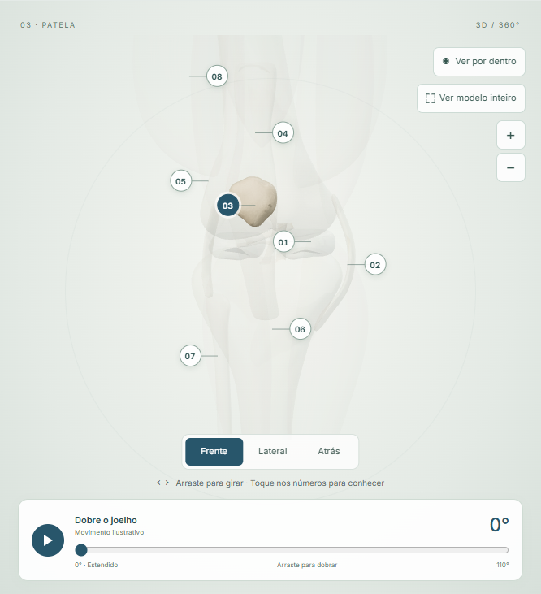
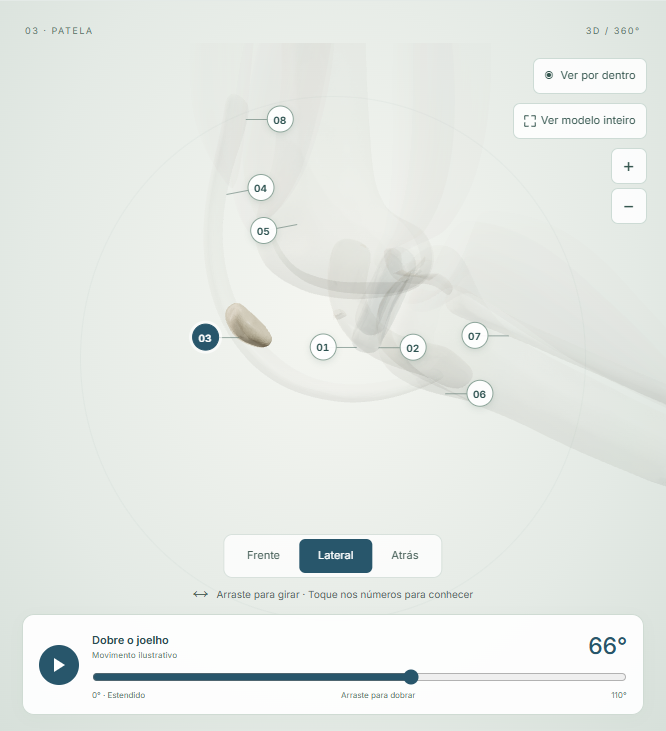
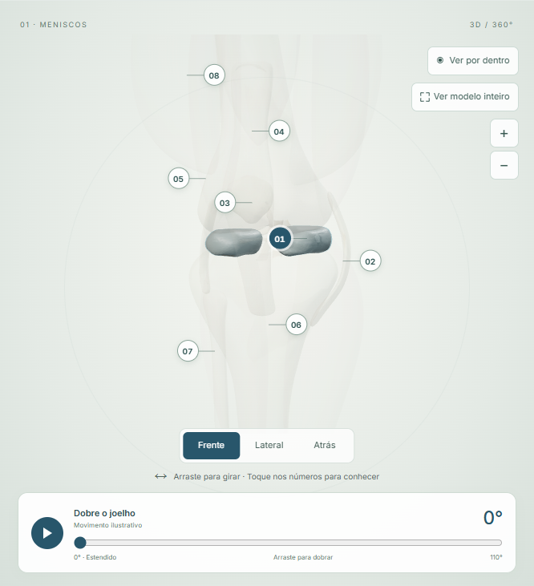
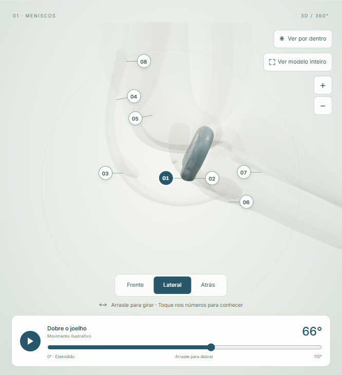
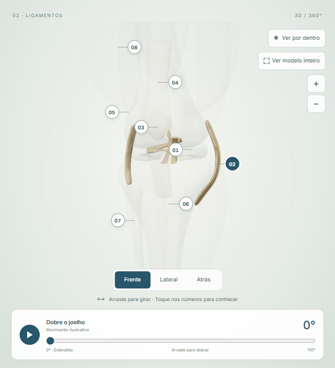
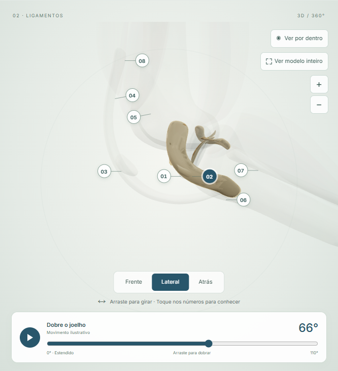

# Revisão anatômica do atlas do joelho

Data da preparação: 18/10/2026. Status: **revisão técnica realizada; aprovação anatômica e clínica pendente**.

Este documento reúne as estruturas selecionáveis, suas superfícies de origem e imagens focadas para revisão pelo Dr. Joaquim. As capturas vêm da aplicação em execução. Não houve aprovação médica nem alteração de forma baseada em medidas anatômicas nesta etapa.

## O que já foi verificado tecnicamente

- Os oito números selecionam o grupo correspondente e mantêm a correspondência com o painel.
- O destaque permite observar patela, meniscos e ligamentos com os outros tecidos suavizados.
- Cada camada pode ser ocultada ou restaurada, sem apagar os textos educativos.
- Os marcadores acompanham os vértices durante a flexão e a rotação da câmera.
- A perna conserva o comprimento e retorna à pose inicial; a animação é uma aproximação visual.

## Conferência por estrutura

| Estrutura | Origem e representação atual | Conferência pelo responsável |
| --- | --- | --- |
| Patela | Superfície `Mash_Low_4`, identificada como `patela`. Independente do aparelho extensor. | Confirmar forma, posição e escala, orientação da face articular e trajetória na flexão. |
| Meniscos | `Mash_Low_2` e `Mash_Low_3`. Ambos selecionados como um grupo. | Confirmar contornos, espessuras, relação com as superfícies articulares e representação em flexão. Não há identificação medial/lateral individual na interface. |
| Ligamentos | `Mash_Low_0`, `_1`, `_5`, `_6`, `_7` e `_8`, agrupados a partir das superfícies do arquivo. | Confirmar quais superfícies representam cada ligamento e suas inserções. A nomeação individual de LCA/LCP/colaterais depende dessa validação. |
| Tendões | `Transparenty_Low_0`, uma malha contínua do aparelho extensor. | Confirmar o trajeto e as inserções. A representação fiel da mecânica pode exigir segmentar os tendões e suas relações com a patela. |
| Ossos | `Bone_Low_0`, `_1` e `_2`, identificados como fêmur, tíbia e fíbula. | Confirmar proporções e alinhamento da articulação. |
| Músculos | Sete volumes originais e procedurais, adicionados para contexto visual. | Confirmar se os volumes e os grupos sugeridos são adequados para uso educativo. Não representam segmentação de paciente. |
| Cartilagem articular | Não está individualizada no modelo fornecido. | Avaliar um modelo com superfície separada antes de oferecer uma seleção específica de cartilagem. A limitação está informada na página. |

## Imagens para inspeção

As imagens laterais foram capturadas em **66°**, posição escolhida para verificar o comportamento intermediário do controle, sem sugerir que essa pose seja clinicamente validada.

### Patela

### Meniscos

### Ligamentos

## Referências editoriais

As referências orientam os textos educativos e a conferência das relações gerais; não validam o arquivo 3D específico.

- [AAOS — Common Knee Injuries](https://www.orthoinfo.org/diseases--conditions/common-knee-injuries/)
- [AAOS — Patellofemoral Pain Syndrome](https://www.orthoinfo.org/diseases--conditions/patellofemoral-pain-syndrome/)

Após a revisão, correções de forma, segmentação e inserções devem ser feitas no modelo e no mapeamento das superfícies. Só depois podem ser atualizadas as trajetórias da animação. Os controles visuais não substituem essa revisão.
